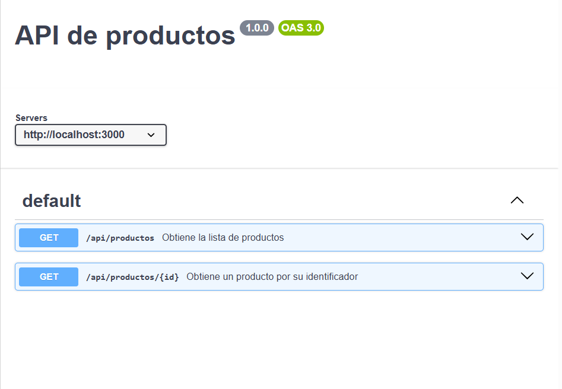

# Documentación de la API

## ¿Qué es OpenAPI?
Es una forma estándar de describir cómo funciona una API en un archivo (en este caso YAML). Sirve para explicar qué rutas tiene, qué métodos acepta y qué datos devuelve, sin importar con qué lenguaje esté programada.

## ¿Para qué sirve Swagger UI?
Es una herramienta que lee el archivo de OpenAPI y genera una página web interactiva para ver la documentación de forma visual y poder probar los endpoints desde el navegador.

## Endpoints
- `GET /api/productos`: Devuelve la lista con todos los productos.
- `GET /api/productos/{id}`: Busca un producto por su id. Si existe devuelve el producto, y si no existe devuelve un error 404.

## Vista en Swagger UI

